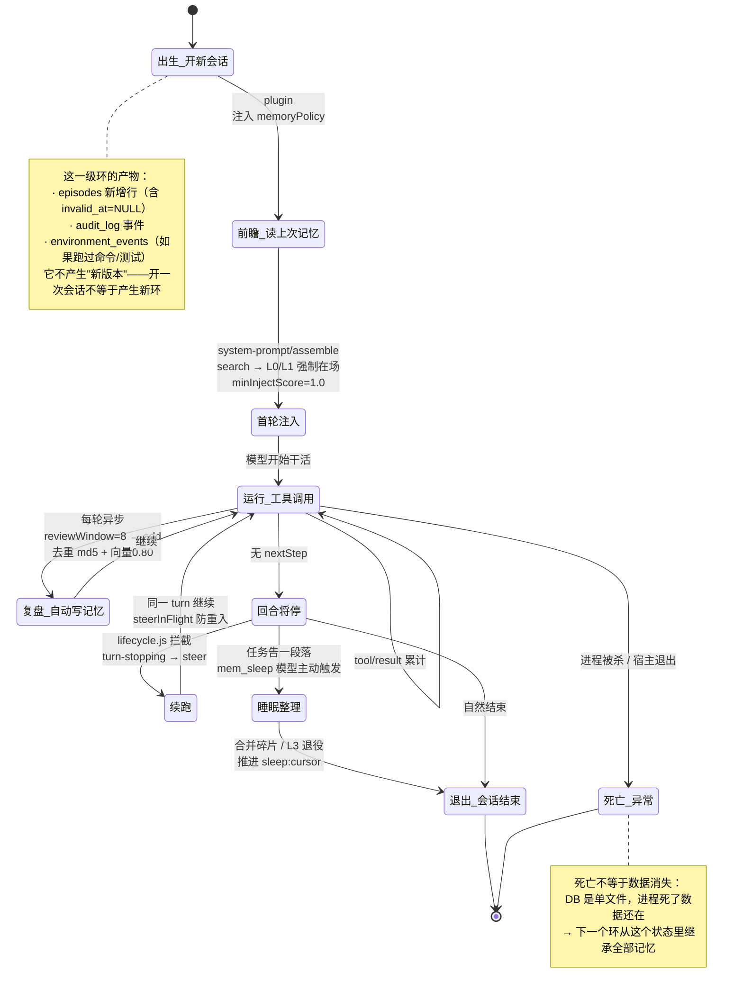
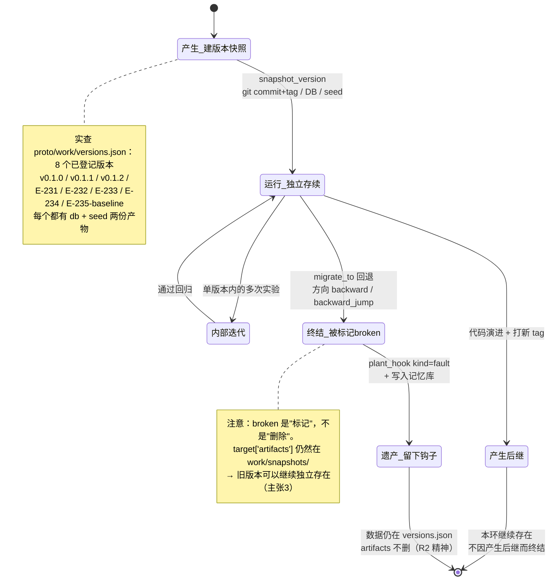
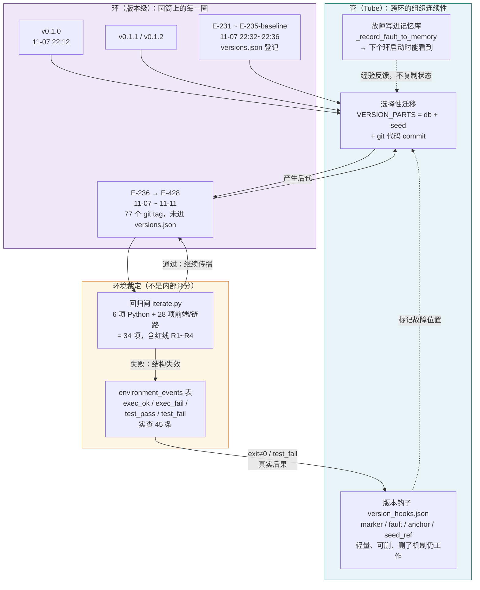
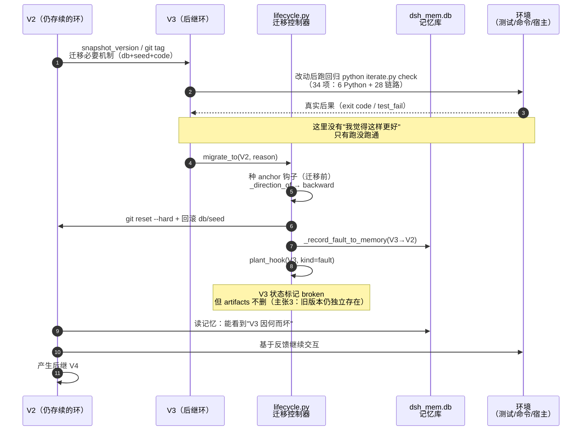
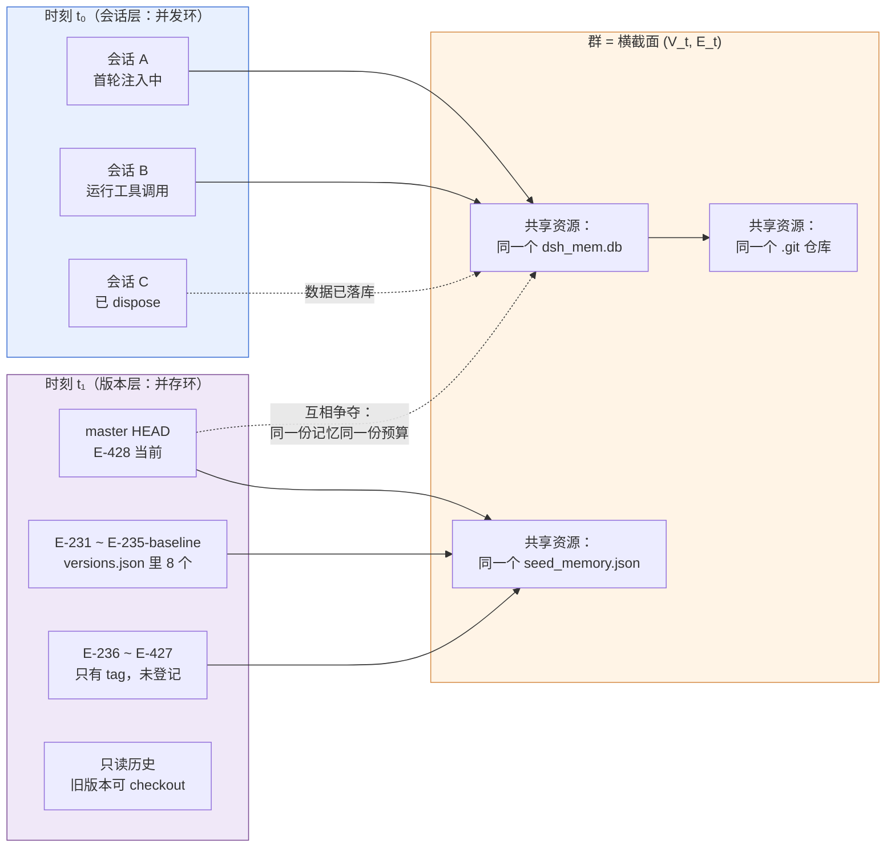
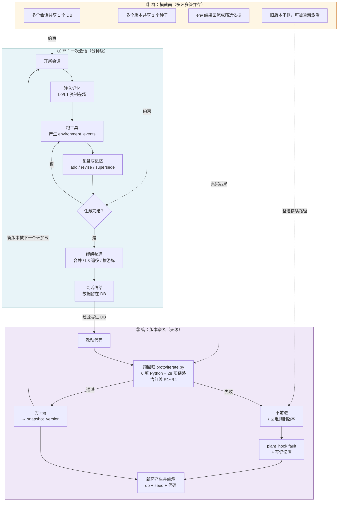
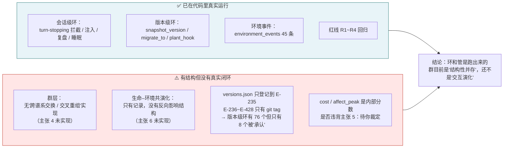
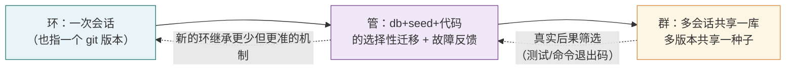

# 肥鱼之心 · 生命周期图（环 / 管 / 群）

> 建立 2026-11-11。**纯 Mermaid 代码，不生成图片。**
> 依据：`docs/` 与 `proto/` 的真实代码（`lifecycle.py`、`cosmos_mem/*.py`、`dsh-plugin/*.js`）、`proto/work/versions.json`、git tag、`dsh_mem.db` 实查。
> 概念命名沿用《跨生命周期自然演化范式：环管群》（思源 `系统/06 素材/12 认知框架/`）。

---

## 0. 先给结论：这个系统里，环/管/群分别是什么

| 层 | 在你框架里的定义 | 本系统里的**真实对应物** | 生命周期有多长 |
|---|---|---|---|
| **环** | 一个有起点、有终结的独立生命周期 | **一次会话（session）× 一次模型实例** | 分钟级 |
| **管** | 多个环通过选择性迁移连成的跨代谱系 | **git 版本链 + `lifecycle.py` 迁移 + 种子/记忆继承** | 天级 |
| **群** | 某时刻多谱系并存的动态横截面 | **master 上同时存活的版本/tag 集合 + 多会话并发** | 时刻截面 |

⚠️ 一个必须先说清的歧义：**"环"在本系统里有两个粒度**，两个都真实存在，不要混：

- **环（会话级）**：一次对话 = 一次生命周期。写完就结束，记忆写进 DB 留给下一个。
- **环（版本级）**：一个 git 版本 = 你原话里的"一次生命周期循环"（`lifecycle.py` 文件头引用了你的原话）。
  它是管上的一个节点，而不是管本身。

下面所有图都会标明是哪一级。

---

## 1. 环 · 会话级生命周期（最小、最频繁的一层）

**为什么这一级叫"环"而不是"管"**：它有明确的起点（agent/created）与终点（会话 dispose），
期间的运行实体是同一个；终结后可识别。按你 2.1 的判据，这就是一个环。

---

## 2. 环 · 版本级生命周期（`lifecycle.py` 说的"一次生命周期循环"）

---

## 3. 管 · 跨版本谱系（选择性迁移，不是全量复制）

**管的关键点（对齐你 3.2 的主张）**：

- 迁移的是**机制**（db + seed + 代码），不是把前代全部状态原样搬过去。
- `_record_fault_to_memory` 只写一条"哪个版本因为什么坏了、退到了哪"，
  **不复制失败版本的状态** → 这就是"经验反馈"而非"运行实例回退"（你 3.5 的机制 A / B 区分）。
- 钩子可删：`clear_hooks()` 清空后迁移机制照常工作，符合"轻量可删标记"。

---

## 4. 管 · V3 失败、回退到 V2、再产生 V4（你 3.5 的图，落到本系统）

---

## 5. 群 · 某一时刻的多谱系横截面

**群的两个真实来源**（都在跑，不是设想）：

1. **版本并存**：`versions.json` 里 8 个版本 + git 76 个 tag，
   旧的不删除、可独立 checkout → 符合主张 3「旧版本可继续独立存在」。
2. **会话并发**：多个 DSH 会话共用同一个 `dsh_mem.db` 与同一份种子
   → 这是横截面上的"竞争同一资源"，也是群层最容易被忽略的耦合点。

---

## 6. 三层套在一起：一个环怎么长成管、管怎么结成群

---

## 7. 诚实标注：图上哪些是已验证的，哪些还没

---

## 8. 一句话总结

**这个系统的"不死"不来自任何一个环活得更久，而来自：环死了，管还在；管断了，群还在。**
而"管"能延续，靠的是选择性迁移（db+seed+code 三件）+ 故障写回记忆库，
不是靠把前一个会话的全部状态搬过去。

---

#生命周期 #环管群 #Mermaid #迁移 #故障传播
