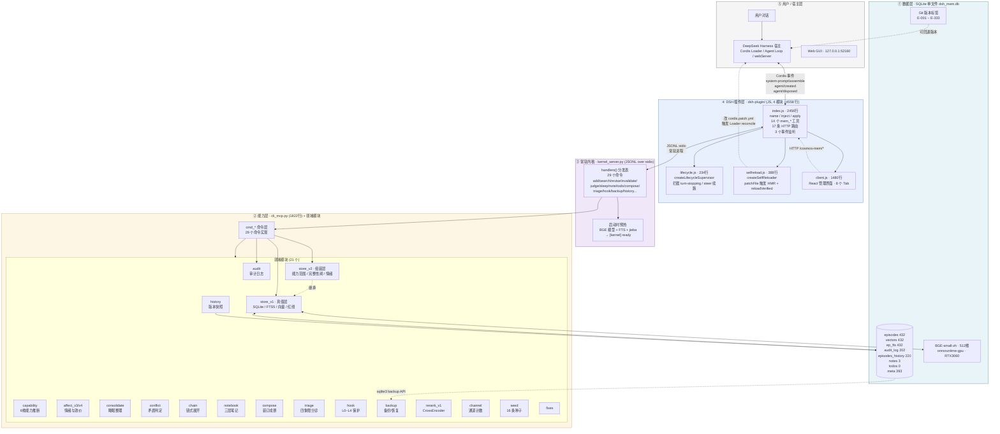
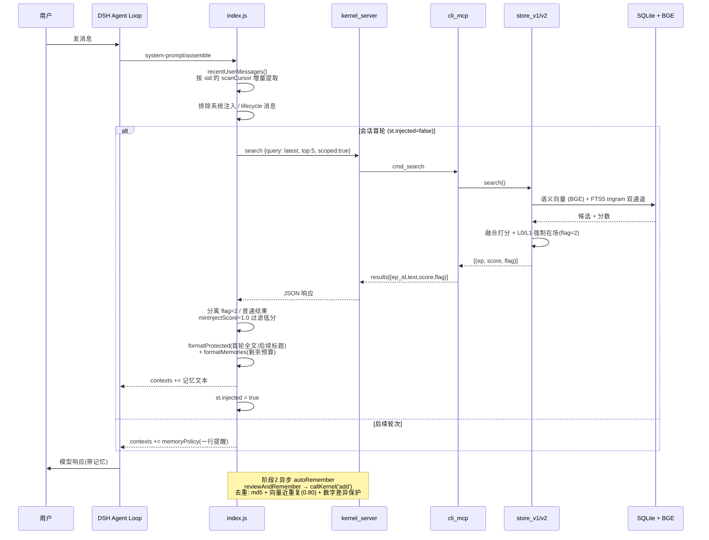
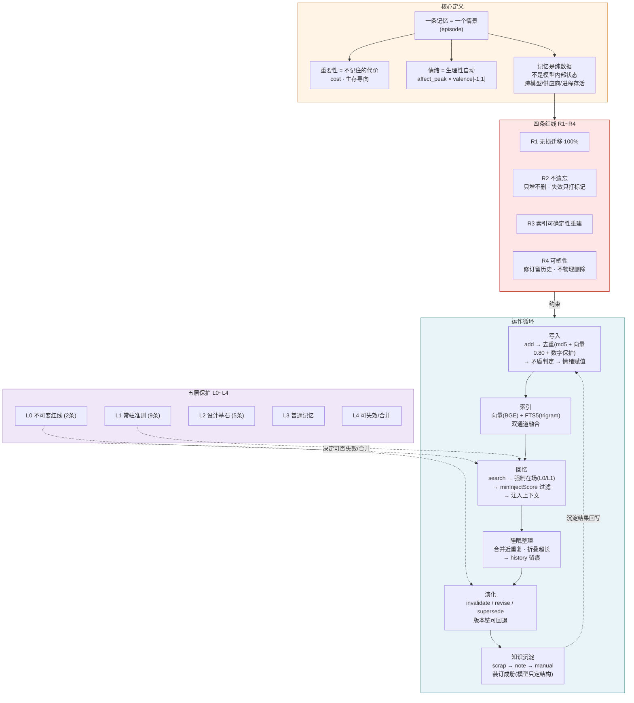
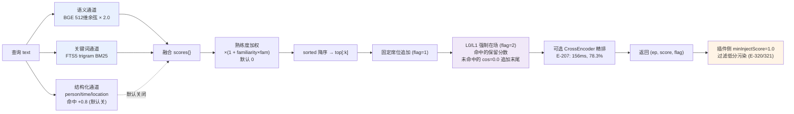

# 肥鱼之心 · 情景记忆系统 — 当前架构图与模型图

> 生成依据：E-338 对真实代码的只读探查（`proto/_inspect_arch.py`），不是凭印象绘制。
> 生成时间：2026-11-10
> 状态：代码版本 E-333，数据库 `proto/cosmos_mem/dsh_mem.db`
> **行数均为 E-338 探查时刻的实测快照；DB 在持续运行，后续迭代会变化。**

---

## 一、系统架构图

### 分层视图

### 请求链路（一次自动注入）

---

## 二、模型图

用户要的「模型图」我理解有两层含义，都给出：**数据模型（存储结构）** 和 **概念模型（记忆是什么 / 如何运作）**。

### 2.1 数据模型（物理存储 · E-338 实测）

**当前实测行数**：episodes 432（有效 78 / 失效 354）、vectors 432、ep_fts 432、audit_log 202、episodes_history 220、notes 3、todos 0、meta 393。

### 2.2 概念模型（记忆是什么 · 怎么运作）

### 2.3 检索打分模型（可跑的数字）

---

## 三、关键设计决策（有实测依据）

| 决策 | 依据 | 数据 |
|---|---|---|
| FTS5 用 trigram 分词 | E-284 | 中文 recall@10：unicode61 2.9% → trigram 24.3% |
| 近重复阈值 0.80 | E-309 标定 | 同件事 0.629~0.916，不同事 0.349~0.532，零误判下识别率最高 |
| minInjectScore 1.0 | E-321 标定 | 保留相关 100% / 过滤无关 60%（最优 1.1，差 0.1） |
| 合并长度上限 1200 字 | E-312/313 | 最长记忆 6637 字 → 969 字，折叠原文进 history |
| 强制注入追加末尾 | E-316/317 | 目标记忆排名从第 4 恢复到第 1 |
| 会话首轮才注入 | E-336 | 主动检索 4 次 / 自动注入 26 次（此设计仍待复核） |
| 自重启改 patch 文件 | E-303 A/B | 只改 patch → 指纹不变；改 index.js 内容 → 指纹变化 |
| sessions 挂 globalThis | E-307 | 模块级 Map 重载后重置导致重复记忆 |
| scanCursor 按 sid + log 重置检测 | E-324/329 | 9 次 log 重置，cursor 失效导致 recentCount 长期 0 |

---

## 四、诚实标注的边界

- **等级与分数是游戏化推算**，不是经能力测评验证的真实能力分数。
- **跨会话连续性来自数据共享**，不是意识；没有对话时不经历任何事。
- 「只注入一次」的设计在 E-336 显示主动检索仅 4 次，**该设计是否最优尚未定论**。
- 图中行数为 E-338 实测快照，后续迭代会变化。

---

## 五、文件位置

| 内容 | 路径 |
|---|---|
| 探查脚本 | `proto/_inspect_arch.py` |
| 本文件（Markdown + Mermaid） | `docs/architecture-and-model.md` |
| 自包含可离线查看 HTML | `docs/architecture-and-model.html` |
