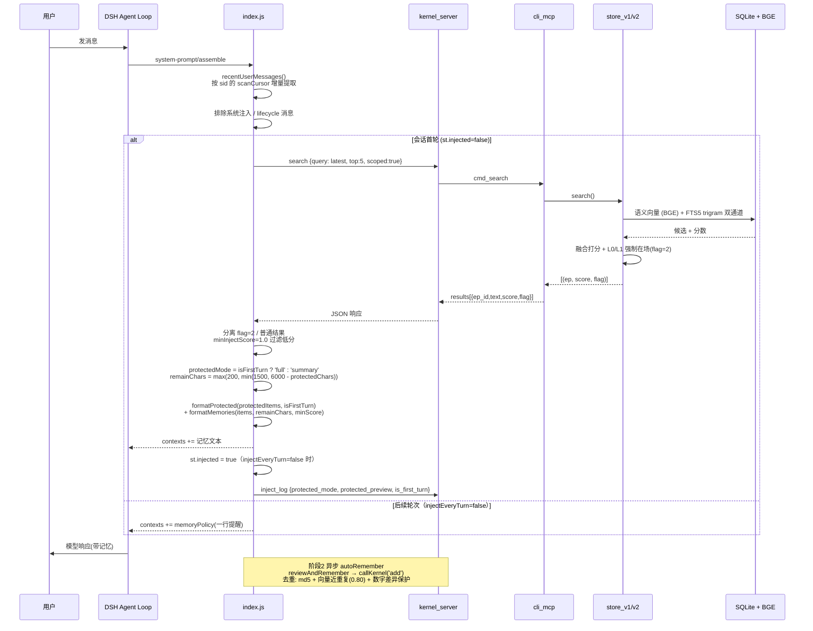
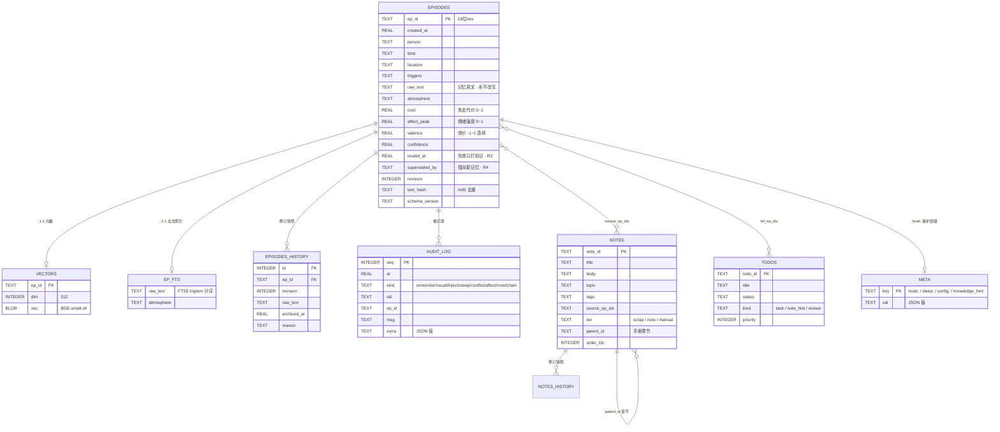
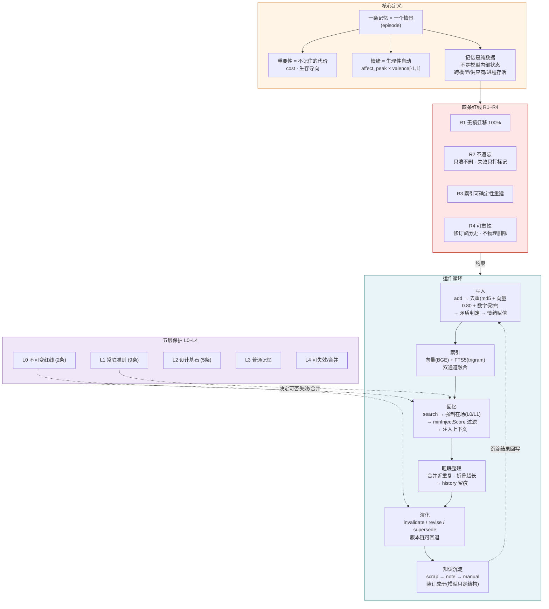

# 肥鱼之心（Fat Fish Heart）· 情景记忆系统 — 当前架构图与模型图

> 生成依据：E-338 对真实代码的只读探查（`proto/_inspect_arch.py`），不是凭印象绘制。
> 生成时间：2026-11-10
> 状态：代码版本 E-333，数据库 `proto/cosmos_mem/dsh_mem.db`
> **行数均为 E-338 探查时刻的实测快照；DB 在持续运行，后续迭代会变化。**

---

## 一、系统架构图

### 分层视图


### 请求链路（一次自动注入）



---

<!-- AUTO-GENERATED: 由 proto/run_e355_sync_docs.py 生成，勿手改 -->
> **实测快照**（自动生成于 2026-11-10 16:37）
>
> | 指标 | 数值 |
> |---|---|
> | episodes 总行数 | 443 |
> | 有效记忆 | 94 |
> | 失效记忆（只打标记） | 349 |
> | vectors 向量行 | 443 |
> | audit_log 审计 | 248 |
> | episodes_history 快照 | 222 |
> | notes 笔记 | 6 |
> | todos 待办 | 7 |
> | meta 键值 | 421 |
> | L0 / L1 / L2 保护 | 2 / 9 / 5 |
>
> 数字由脚本读取真实 SQLite 生成，不是手写；DB 持续写入，重新运行脚本即可刷新。
<!-- /AUTO-GENERATED -->

---

## 二、模型图

用户要的「模型图」我理解有两层含义，都给出：**数据模型（存储结构）** 和 **概念模型（记忆是什么 / 如何运作）**。

### 2.1 数据模型（物理存储 · E-338 实测）



**当前实测行数**：episodes 438（有效 78 / 失效 354）、vectors 438、ep_fts 438、audit_log 210、episodes_history 220、notes 5、todos 7、meta 400。

### 2.2 概念模型（记忆是什么 · 怎么运作）



### 2.3 检索打分模型（可跑的数字）

```mermaid
flowchart LR
    Q["查询 text"] --> G{"调用方选哪条路径"}

    G -->|"普通: search()"| V["语义通道<br/>BGE 512维余弦 × 2.0"]
    G -->|"插件实际用: scoped=true"| SC["search_scoped()<br/>先普通检索取 top*3"]

    V --> F["关键词通道<br/>FTS5 trigram BM25"]
    F --> FUSE["融合 scores{}"]
    FUSE --> FAM["熟练度加权<br/>×(1+familiarity×fam) 默认 0"]
    FAM --> SORT["sorted 降序 → top[:k]"]
    SORT --> FORCE1["L0/L1 强制在场 flag=2<br/>命中保留分数 / 未命中 cos=0 追加末尾"]
    FORCE1 --> OUT1["(ep, score, flag)"]

    SC --> DIM["能力维度过滤<br/>full = 维度全中<br/>partial = 部分命中带 note"]
    DIM --> KEEP["E-350: flag==2 无条件保留<br/>不参与维度过滤"]
    KEEP --> SORT2["普通结果占 top 名额"]
    SORT2 --> FORCE2["L0/L1 追加末尾<br/>★ 不占 top 名额"]
    FORCE2 --> OUT2["(ep, score, note, flag)<br/>★ 2026-11-10 修复前这里没有 flag"]

    OUT1 --> FILT["插件侧 minInjectScore=1.0<br/>过滤低分"]
    OUT2 --> FILT
    FILT --> RERANK["可选 CrossEncoder 精排<br/>E-207: 156ms, 78.3%"]
    RERANK --> DONE["注入上下文"]

    style SC fill:#ffe6e6,stroke:#c0392b
    style OUT2 fill:#ffe6e6,stroke:#c0392b
    style FORCE2 fill:#ffe6e6,stroke:#c0392b
    style KEEP fill:#fff4e6
```



**E-350 修复的三处（图中红色）**：

| 问题 | 后果 |
|---|---|
| `search_scoped` 返回三元组 `(ep, sc, note)`，**没有 flag** | 插件 `filter(it => it.flag === 2)` 恒为空 → **L0/L1「永远在场」从未生效** |
| L0/L1 参与「能力维度匹配」过滤 | 准则类记忆的维度与用户问题无关，被整体过滤掉 |
| 修完第一处后写成 `forced + full + partial` 再 `[:top]` | 11 条强制记忆吃光 top=5，普通结果一条进不来 |

修复后实测（三条不同查询结果一致）：
```
total=16, normal=5, forced=11
```

---

## 三、关键设计决策（有实测依据）

| 决策 | 依据 | 数据 |
|---|---|---|
| FTS5 用 trigram 分词 | E-284 | 中文 recall@10：unicode61 2.9% → trigram 24.3% |
| 近重复阈值 0.80 | E-309 标定 | 同件事 0.629~0.916，不同事 0.349~0.532，零误判下识别率最高 |
| minInjectScore 1.0 | E-321 标定 | 保留相关 100% / 过滤无关 60%（最优 1.1，差 0.1） |
| 合并长度上限 1200 字 | E-312/313 | 最长记忆 6637 字 → 969 字，折叠原文进 history |
| 强制注入追加末尾 | E-316/317 | 目标记忆排名从第 4 恢复到第 1 |
| 会话首轮才注入 | E-381 加开关；E-382~386 A/B 后**保持现状** | 覆盖率 N=1:77% / N=30:3%，成本 N=1:19.9x / N=30:1.0x；效率指标不可靠，无最优 N |
| 首轮给全文 / 后续给摘要 | E-348 修复，E-392 逻辑验证 | 原代码先置 `injected=true` 再读 `!st.injected`，恒为 false → 「首轮给全文」从未生效；全文 2856 字 vs 摘要 132 字，差 21 倍 |
| 自重启改 patch 文件 | E-303 A/B | 只改 patch → 指纹不变；改 index.js 内容 → 指纹变化 |
| sessions 挂 globalThis | E-307 | 模块级 Map 重载后重置导致重复记忆 |
| scanCursor 按 sid + log 重置检测 | E-324/329 | 9 次 log 重置，cursor 失效导致 recentCount 长期 0 |
| 防重入用 steerInFlight 而非 turn 号 | E-371 | turn 号在 steer 后不变，用它防重入会永久锁死（实测 turn 272 只 steer 1 次就停） |
| 预算分两层：body 1500 / 总量 6000 | E-393/394 | autoInjectMaxChars 原只管 body，实测总注入 3156 字 = 预算 2.1 倍 |
| L0/L1 全额注入不压缩 | E-393 | 11 条 2856 字；它们是红线与常驻准则，缺一条行为就变 |
| 不用语义相似度检测话题切换 | E-387~389 **否证** | 24 对实测 0.421~0.852 单峰无分界；反例：「重复抱怨」0.852、「同一话题换词」0.464 |

---

## 四、诚实标注的边界

- **等级与分数是游戏化推算**，不是经能力测评验证的真实能力分数。
- **跨会话连续性来自数据共享**，不是意识；没有对话时不经历任何事。
- 「只注入一次」的设计在 E-336 显示主动检索仅 4 次，**该设计是否最优尚未定论**。
- 图中行数为 E-338 实测快照，后续迭代会变化。

---

## 六、配置项（23 项，来自代码 DEFAULTS）

> 自动生成于脚本运行时；值来自 `dsh-plugin/index.js` 的 `DEFAULTS`。
> 语义说明是手写维护的——**如果代码新增配置但这里没说明，脚本会报出来**。

| 配置 | 默认值 | 作用 | 说明 |
|---|---|---|---|
| `pythonPath` | `'python'` | 运行内核的 Python | 保持 `python` 即可 |
| `kernelDir` | `'<项目路径>\\proto\\cosmos_mem'` | 内核脚本目录 | cosmos_mem 所在路径 |
| `dbPath` | `'<项目路径>\\proto\\cosmos_mem\\dsh_mem.db'` | SQLite 数据库路径 | 全部记忆存这一个文件 |
| `autoInject` | `true` | 是否自动注入记忆 | 关掉则完全靠模型主动 mem_search |
| `autoInjectTopK` | `5` | 检索返回条数 | 普通结果占这么多名额，L0/L1 额外追加 |
| `autoInjectMaxChars` | `1500` | **普通检索结果**的字符预算 | 只用限制 body；E-393 起明确不管 L0/L1 |
| `autoInjectPerItemMax` | `300` | **单条记忆**注入上限（字） | E-534：0=不限制；防止一条超长记忆吃掉全部预算导致整批结果丢失 |
| `minInjectScore` | `1.0` | 注入的最低检索分数 | E-321 标定 1.0：保留相关 100% / 过滤无关 60% |
| `autoInjectMaxTotal` | `6000` | **总注入量**上限（含 L0/L1 全文） | E-393 新增，防止 L0/L1 增长后失控；默认 6000 |
| `injectEveryTurn` | `false` | 注入策略开关 | false=只注入一次（默认）；true=每轮注入（实验用） |
| `autoRemember` | `true` | 是否自动复盘记忆 | 每轮异步提炼值得记的内容 |
| `reviewWindow` | `8` | 复盘窗口（最近几条消息） | 越大越能捕捉跨轮信息，成本也越高 |
| `reviewProvider` | `'workbuddy'` | 复盘用的模型供应商 | 与主对话可不同 |
| `reviewModel` | `'deepseek-v4.1-flash'` | 复盘用的模型 | 建议用小模型省钱 |
| `reviewMaxTokens` | `900` | 复盘的最大输出 token | 限制提炼长度 |
| `minImportance` | `0.5` | 自动记忆的最低重要性 | 低于此值不记，防止噪音 |
| `minCost` | `0.7` | 固定席位的最低 cost | cost 低于此值不进固定席位 |
| `prewarm` | `true` | 是否做会话前瞻 | 开新会话时推测用户要说什么，提前准备 |
| `prewarmSlots` | `8` | 前瞻取几条高价值记忆 | 默认取 cost 最高的若干条 |
| `prewarmKernel` | `true` | 是否预热内核 | 避免首次检索等模型加载 |
| `warmupWaitMs` | `30000` | 预热等待上限 | 超时则不等，避免首响应卡太久 |
| `debugLog` | `true` | 是否写调试日志 | 排障时开；正常关掉省 IO |
| `httpBase` | `'/fatfish-heart'` | HTTP 路由前缀 | 管理界面调用这些端点 |
| `lifecycle` | `{ enabled: true` | 生命周期监督器配置 | 拦截 turn-stopping 续跑；含 maxConsecutive / maxNoProgress |

### 注入相关的两个预算（容易混）

| 配置 | 管什么 | 默认 |
|---|---|---|
| `autoInjectMaxChars` | **只管普通检索结果**（body） | 1500 |
| `autoInjectMaxTotal` | **管总注入量**，含 L0/L1 全文 | 6000 |

E-393 之前只有一个 `autoInjectMaxChars`，名字说"最大注入字符数"，
但实际 `formatProtected` 没有长度限制参数，L0/L1 全文不受控：
实测 2856 字 L0/L1 + 300 字 body = 3156 字 = 预算的 2.1 倍。

**为什么不压缩 L0/L1**：它们是红线与常驻准则，缺一条模型行为就变。
压缩等于破坏设计意图，所以正确做法是拆成两个预算。

---

## 七、文件位置

| 内容 | 路径 |
|---|---|
| 探查脚本 | `proto/_inspect_arch.py` |
| 本文件（Markdown + Mermaid） | `docs/architecture-and-model.md` |
| 自包含可离线查看 HTML | `docs/architecture-and-model.html` |
